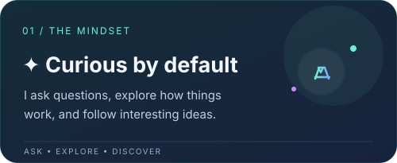
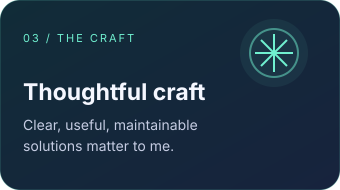
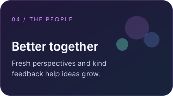
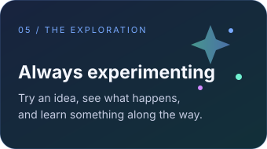

  

  <a href="https://github.com/samoserv">GitHub Profile</a>　·　<strong>Build</strong>　·　<strong>Learn</strong>　·　<strong>Repeat</strong>

---

  

## A few things that guide me

  
  

## More about how I work

  
  
  

## What I’m building

This profile is a work in progress—just like the projects here. Explore my repositories to see what I’m experimenting with, and check back as I keep adding to them.

## Let’s connect

Have an idea, suggestion, or kind bit of feedback? You’re welcome to start a conversation through [my GitHub profile](https://github.com/samoserv).

  Thanks for stopping by. Make something meaningful today ✨

